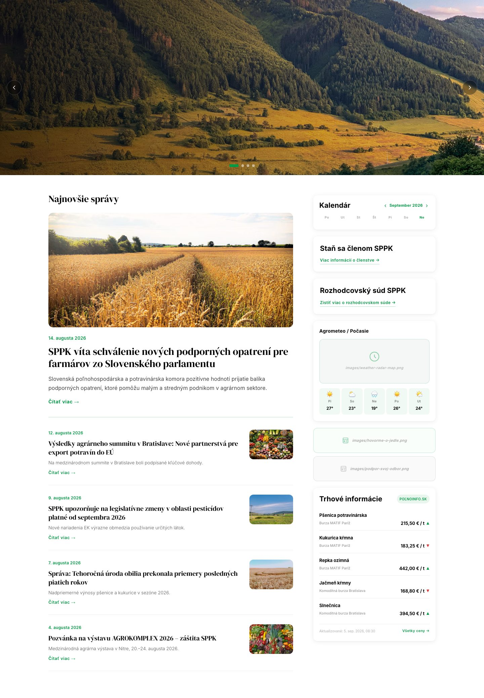
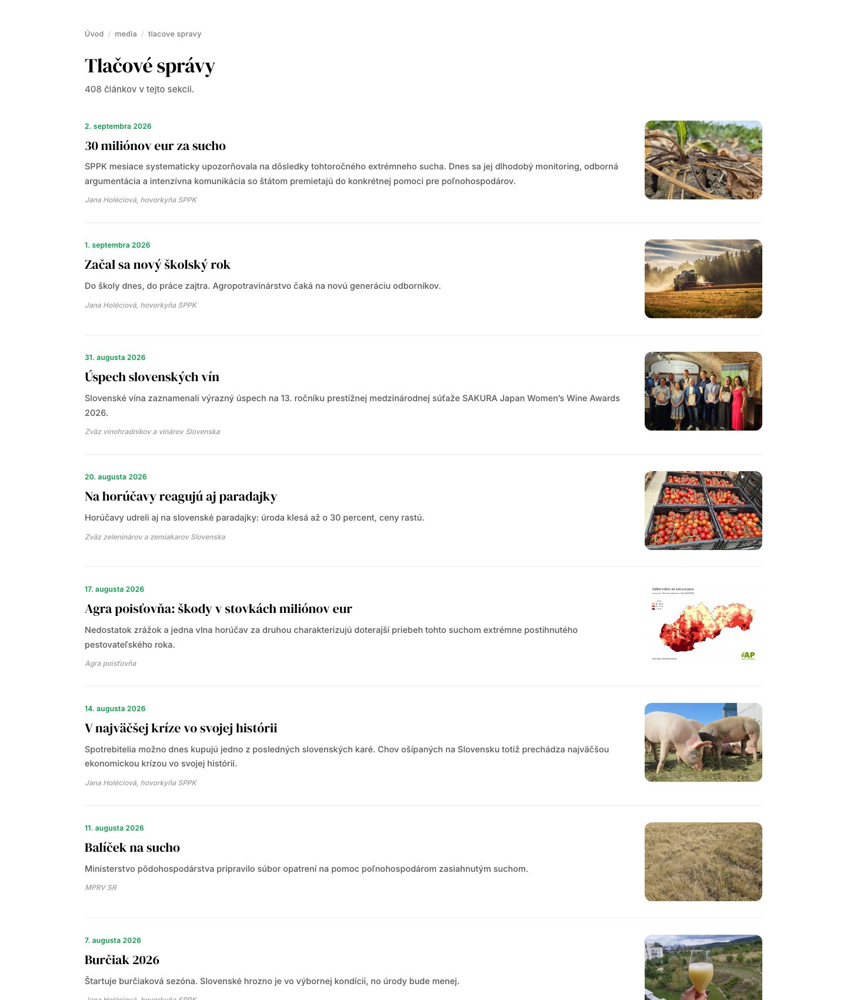
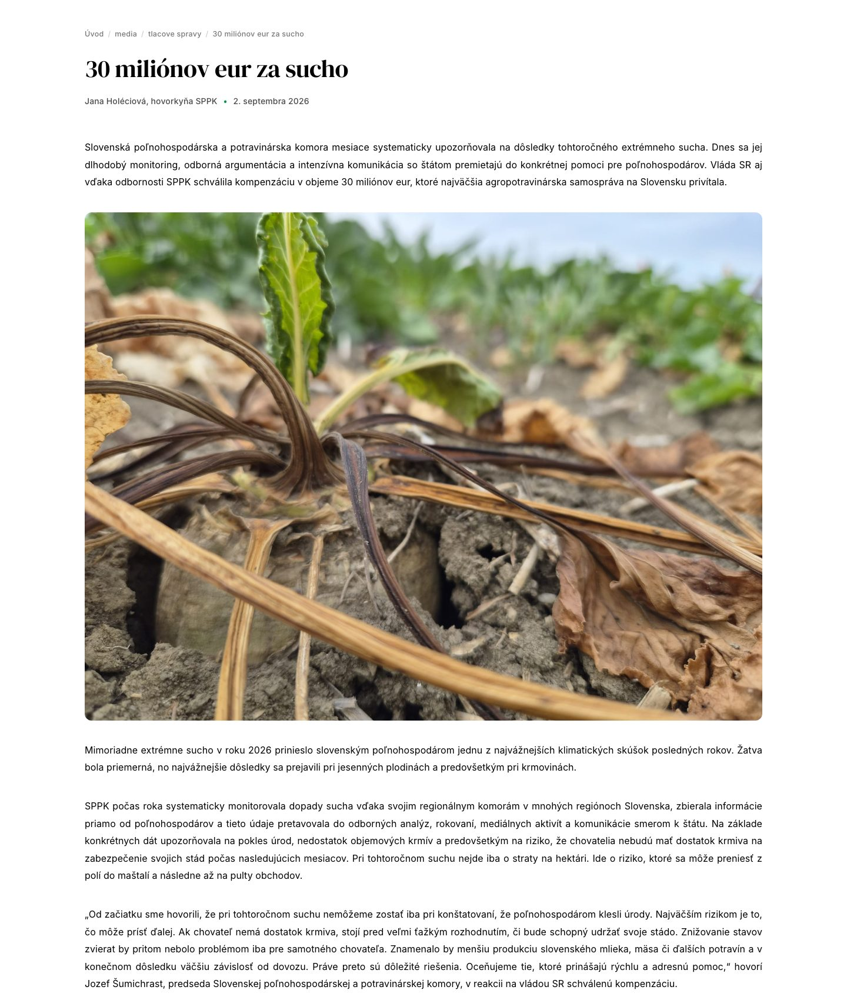
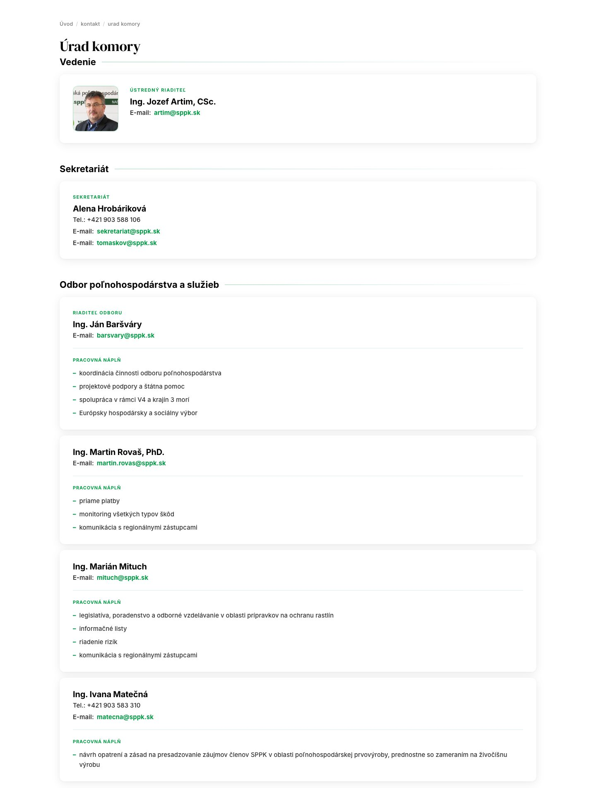
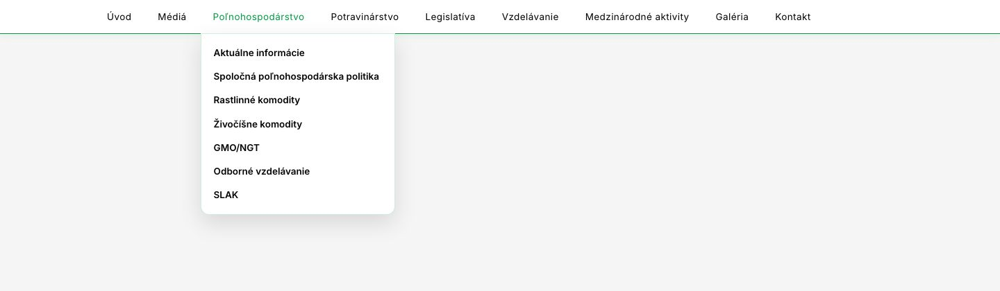
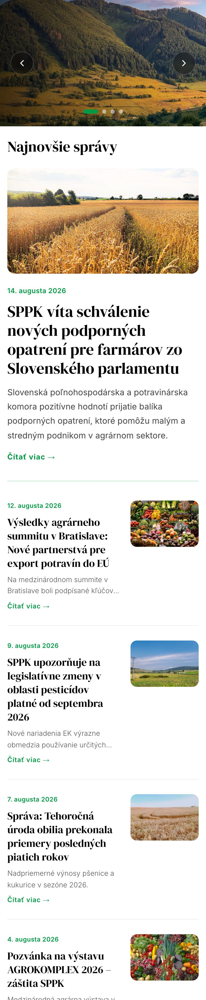

# sppk-web

**Slovensky** | [English](README.en.md)

Prestavba webu sppk.sk (Slovenská poľnohospodárska a potravinárska komora) na
samostatné statické HTML súbory. Vychádza z dizajnov dodaných po častiach ako Figma
Make exporty a z priečinkovej štruktúry webu od klienta. Výstup je 5402 stránok,
v každom priečinku jeden `index.html`, bez frameworku a bez databázy.

## Ako to vyzerá

Obrázky sú z hotového výstupu vo `web/`, nie z mockupov. Stránky sú zámerne len obsah
bez hlavičky a pätičky. Tie sú samostatné súbory (`web/Header`, `web/Menu`,
`web/Footer`, `web/tretina`), ktoré sa k stránkam pripájajú až pri nasadení.

**Úvodná stránka:** slider, najnovšie správy, kalendár a pravý stĺpec.



**Výpis tlačových správ:** 408 článkov, každý má vlastnú stránku.



**Článok** prenesený zo starého CMS: perex, meta riadok, obrázky vycentrované, text do bloku.



**Kontakt, Úrad komory:** karty s portrétmi a maily dekódovanými z Cloudflare.



**Menu** s 144 položkami, hlbšie úrovne sa otvoria po nabehnutí na rodiča.



**Telefón (393 px):** ten istý súbor bez úprav.



## Pozrieť si to naživo

Netreba nič inštalovať okrem Pythonu:

```bash
git clone https://github.com/matuskalis/sppk-web.git
cd sppk-web/web
python3 -m http.server 8099
```

Potom otvoriť `http://localhost:8099/`. Zaujímavé stránky:
`/media/tlacove spravy/`, `/kontakt/urad komory/`, `/galeria/`, `/Menu/`.

## Čísla

| | |
|---|---|
| stránok vo výstupe | 5402 |
| interných odkazov, všetky overené | 36 255 |
| článkov prenesených zo starého CMS | 5323 |
| položiek menu | 144 |
| priečinkov v štruktúre od klienta | 197 |
| albumov v galérii | 48 |
| generátor | 2 292 riadkov JavaScriptu, jediná závislosť `cheerio` |
| veľkosť výstupu | 222 MB |

Celý web sa prestaví jedným príkazom a `npm test` ho overí: výsledok `BEZ CHÝB`.

## Ako to funguje

```
scraper (sppk-redesign)   JSON so všetkým obsahom zo sppk.sk
design/                   dodané dizajny a zadania
struktura/                priečinkový strom webu od klienta (197 priečinkov)
        |
        v
scripts/build-web.mjs     pre každý priečinok nájde obsah a vyplní šablónu
templates/                HTML šablóny (príspevok, výpis, galéria, úvodná)
        |
        v
web/                      hotový web, index.html v každom priečinku
```

Obsah sa páruje s priečinkom podľa URL, potom podľa názvu článku, pri galérii
podľa názvu albumu. Názvy priečinkov majú preklepy oproti živým adresám, preto po
presnej zhode nasleduje porovnanie cez trojznakové úseky.

## Spustenie

```bash
npm install
npm test                               # kontrola hotového web/, musí skončiť "BEZ CHÝB"
cd web && python3 -m http.server 8099  # prezeranie
```

Web treba prezerať zo servera. Menu vkladá odkazy od koreňa (`/uvod/index.html`),
lebo sa pridáva do stránok v rôznych hĺbkach, cez `file://` nefungujú.

`npm run build` web prestaví. Číta JSON zo scrapera, ktorý žije v samostatnom repe
`sppk-redesign` (`scraper/data-full/`) a nie je súčasťou tohto repa. Bez neho
funguje `npm test` a prezeranie hotového `web/`, prestavba nie.

## Čo je kde

| cesta | obsah |
|---|---|
| `scripts/build-web.mjs` | hlavný generátor: prejde `struktura/`, píše `web/` |
| `scripts/build-komponenty.mjs` | hlavička, menu (144 položiek), pätička a pravá tretina ako samostatné súbory |
| `scripts/build-vypis.mjs`, `build-galeria.mjs`, `build-homepage.mjs` | výpisy článkov, galéria, úvodná stránka |
| `scripts/fill.mjs` | naplní šablónu príspevku vybranými článkami podľa ID |
| `scripts/kontrola.mjs` | kontrola výstupu po builde |
| `templates/` | HTML šablóny a spoločné CSS |
| `design/` | dodané dizajny, zadania a komponenty |
| `docs/POZNAMKY.md` | podrobný vývojový denník: rozhodnutia, pasce, čísla |

## Čo robí `npm test`

`scripts/kontrola.mjs` prejde každú stránku vo `web/` a overuje:

- každý interný odkaz a obrázok sa dá nájsť na disku
- inline skripty komponentov sa dajú rozparsovať
- nikde nezostal skrytý mail (`[email protected]`), wordovský `file:///` odkaz ani
  trieda `Mso*`
- dva články si nesadli na tú istú cestu
- žiadna stránka nezostala bez jediného odkazu

Každá z týchto chýb sa už raz dostala do odovzdaného výstupu, preto je na ne kontrola.

## Čo na tom bolo ťažké

- **Zhoda obsahu s priečinkami.** Klient poslal strom priečinkov s preklepmi v
  názvoch, obsah prišiel zo scrapera pod inými titulkami. Generátor páruje najprv
  podľa URL, potom podľa názvu, nakoniec cez porovnanie trojznakových úsekov, a
  päť tisíc článkov dostane vlastný priečinok.
- **Obsah, ktorý nikto nestrážil.** Texty písané vo Worde a v editore starého CMS:
  odseky v `<div>`, pevné pixelové rozmery, prázdne `&nbsp;` riadky,
  `Mso*` triedy. Normalizácia bola overená na všetkých 5323 článkoch bez straty
  odkazu, obrázka, videa, tabuľky alebo položky zoznamu.
- **Skryté maily.** Cloudflare na sppk.sk maily kóduje (`data-cfemail`). Generátor
  ich dekóduje späť a vkladá ako `mailto:`: 604 adries v 355 článkoch.
- **Dizajn dodaný po kúskoch.** Figma Make exporty prichádzali po častiach a niektoré
  používali Tailwind cez CDN. Výstup je sjednotený na samostatné súbory s inline CSS,
  aby každý `index.html` fungoval sám, aj keď ho niekto otvorí mimo repa.
- **Kontrola, ktorá sa učila.** Každá chyba, ktorá raz prešla do odovzdaného webu,
  dostala v `scripts/kontrola.mjs` vlastné pravidlo.

## Čo sa pri obsahu rieši

- **Čistenie starého CMS.** Odseky v `<div>`, inline štýly, `&nbsp;` medzery, pevné
  pixelové rozmery obrázkov a Wordové triedy sa pri vkladaní normalizujú.
- **Maily.** sppk.sk ich skrýva cez Cloudflare (`data-cfemail`). Generátor ich
  dekóduje a vkladá ako `mailto:`.
- **Členský obsah.** 900 článkov je na sppk.sk len pre prihlásených. Vo výstupe majú
  zelený rámček s vetou o členskom prístupe a výpis ich označuje.
- **Typografia podľa zadania.** Text zarovnaný do bloku, obrázky vycentrované a
  nikdy neobtekané, externé odkazy so šípkou `↗`, zelené odrážky `#009a44`.

## Známe obmedzenia

- Vyhľadávanie v hlavičke je zatiaľ mŕtve, potrebuje databázu.
- Počasie v pravej tretine potrebuje serverovú časť, statická stránka živé dáta
  nenatiahne.
- 25 položiek menu nemá v štruktúre priečinok a vedie zatiaľ na sppk.sk.
- Ochrana mailov proti robotom (mail ako obrázok) je odložená.
- 5 stránok je bez obsahu, nemajú ho ani na živom webe. Zobrazia sa s viditeľným
  rámčekom.
