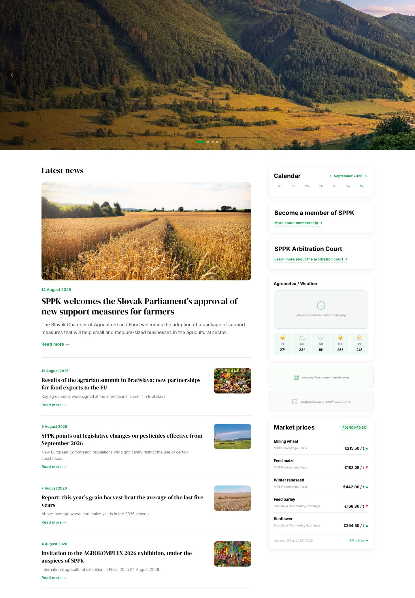
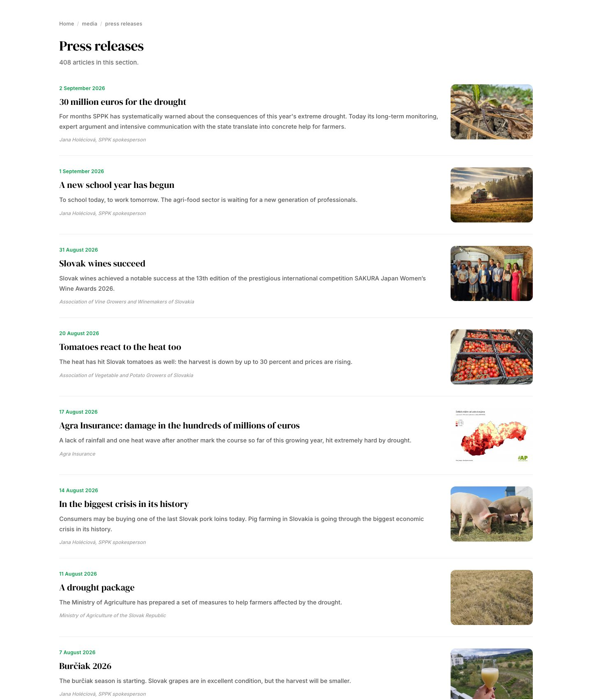
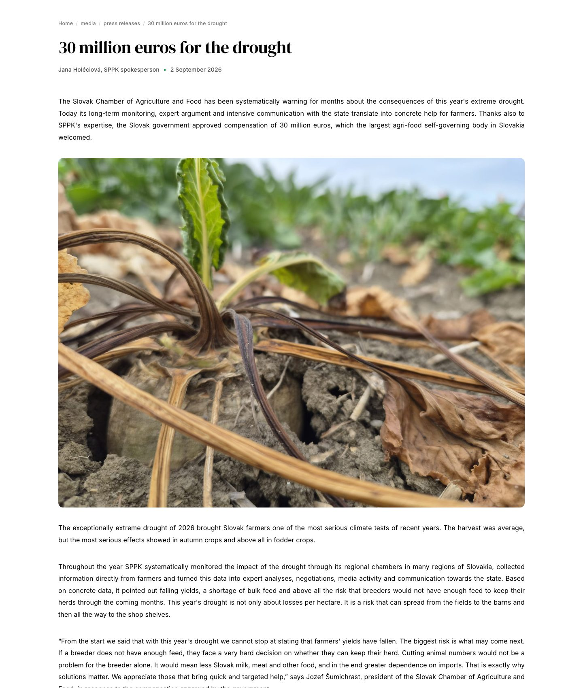
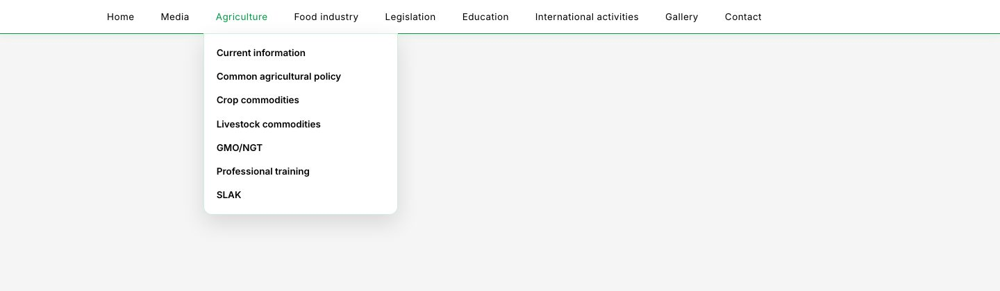
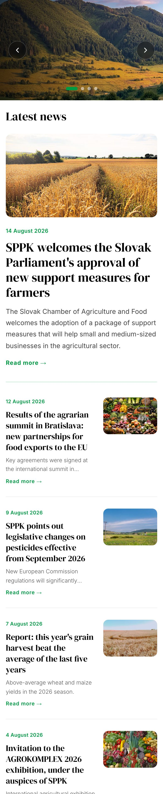

# sppk-web

[Slovensky](README.sk.md) | **English**

A rebuild of sppk.sk, the website of the Slovak Chamber of Agriculture and Food
(SPPK), as standalone static HTML files. It starts from designs delivered in parts as
Figma Make exports and from the folder structure of the site supplied by the client.
The output is 5402 pages, one `index.html` per folder, with no framework and no
database. Page content and folder names are in Slovak.

## What it looks like

The images below are taken from the finished output in `web/`, not from mockups. The
site itself is in Slovak, so the text in these screenshots was translated into English
in the browser for this README. The Slovak originals are in
[README.sk.md](README.sk.md). The pages are deliberately content only, without header and footer. Those are separate
files (`web/Header`, `web/Menu`, `web/Footer`, `web/tretina`) that get attached to the
pages at deployment.

**Home page:** slider, latest news, calendar and the right-hand column.



**Press release listing:** 408 articles, each with its own page.



**An article** migrated from the old CMS: lead paragraph, meta line, centred images,
justified text.



**Contact, the chamber's office:** cards with portraits and e-mail addresses decoded
from Cloudflare protection.


**Menu** with 144 items. Deeper levels open when the pointer moves onto their parent.



**Phone (393 px wide):** the same file, unchanged.



## See it live

Nothing to install except Python:

```bash
git clone https://github.com/matuskalis/sppk-web.git
cd sppk-web/web
python3 -m http.server 8099
```

Then open `http://localhost:8099/`. Pages worth a look:
`/media/tlacove spravy/`, `/kontakt/urad komory/`, `/galeria/`, `/Menu/`.

## Numbers

| | |
|---|---|
| pages in the output | 5402 |
| internal links, all verified | 36 255 |
| articles migrated from the old CMS | 5323 |
| menu items | 144 |
| folders in the client's structure | 197 |
| albums in the gallery | 48 |
| generator | 2 292 lines of JavaScript, a single dependency, `cheerio` |
| size of the output | 222 MB |

The whole site is rebuilt with one command and `npm test` checks it. The script prints
its result in Slovak: `BEZ CHÝB` means "no errors".

## How it works

```
scraper (sppk-redesign)   JSON with all content from sppk.sk
design/                   delivered designs and briefs
struktura/                folder tree of the site from the client (197 folders)
        |
        v
scripts/build-web.mjs     finds the content for each folder and fills a template
templates/                HTML templates (article, listing, gallery, home page)
        |
        v
web/                      the finished site, an index.html in every folder
```

Content is matched to a folder by URL first, then by article title, and for the gallery
by album name. Folder names contain typos compared with the live addresses, so after
an exact match the generator falls back to comparing three-character chunks.

## Running it

```bash
npm install
npm test                               # checks the finished web/, must end with "BEZ CHÝB"
cd web && python3 -m http.server 8099  # browse it
```

The site has to be viewed through a server. The menu inserts links from the site root
(`/uvod/index.html`) because it is attached to pages at different depths, so they do
not work over `file://`.

`npm run build` rebuilds the site. It reads JSON from the scraper, which lives in a
separate repo, `sppk-redesign` (`scraper/data-full/`), and is not part of this one.
Without it `npm test` and browsing the finished `web/` work, rebuilding does not.

## What is where

| path | contents |
|---|---|
| `scripts/build-web.mjs` | main generator: walks `struktura/`, writes `web/` |
| `scripts/build-komponenty.mjs` | header, menu (144 items), footer and right-hand column as separate files |
| `scripts/build-vypis.mjs`, `build-galeria.mjs`, `build-homepage.mjs` | article listings, gallery, home page |
| `scripts/fill.mjs` | fills the article template with chosen articles by ID |
| `scripts/kontrola.mjs` | check of the output after a build |
| `templates/` | HTML templates and shared CSS |
| `design/` | delivered designs, briefs and components |
| `docs/POZNAMKY.md` | detailed development log (in Slovak): decisions, traps, numbers |

## What `npm test` does

`scripts/kontrola.mjs` walks every page in `web/` and checks that:

- every internal link and image can be found on disk
- the inline component scripts parse
- no hidden e-mail (`[email protected]`), Word `file:///` link or `Mso*` class is left
- no two articles collide on the same path
- no page is left without a single link

Each of these errors once reached a delivered build, which is why there is a check for
it.

## What was hard

- **Matching content to folders.** The client sent a folder tree with typos in the
  names, and the content came from the scraper under different titles. The generator
  matches by URL, then by title, then by three-character chunks, and five thousand
  articles each get their own folder.
- **Content nobody policed.** Text written in Word and in the old CMS editor:
  paragraphs in `<div>`, fixed pixel sizes, empty `&nbsp;` rows, `Mso*` classes. The
  normalisation was verified on all 5323 articles with no loss of a link, image,
  video, table or list item.
- **Hidden e-mails.** Cloudflare on sppk.sk encodes e-mail addresses
  (`data-cfemail`). The generator decodes them and inserts `mailto:` links: 604
  addresses in 355 articles.
- **Design delivered in pieces.** The Figma Make exports arrived in parts and some used
  Tailwind from a CDN. The output is unified into standalone files with inline CSS, so
  every `index.html` works on its own, even when opened outside the repo.
- **A check that kept learning.** Every error that once slipped into a delivered build
  got its own rule in `scripts/kontrola.mjs`.

## Content handling

- **Cleaning the old CMS.** Paragraphs in `<div>`, inline styles, `&nbsp;` spacing,
  fixed pixel sizes on images and Word classes are normalised on insertion.
- **Members-only content.** 900 articles on sppk.sk are visible only to logged-in
  users. In the output they get a green box with a line about member access, and
  listings mark them.
- **Typography from the brief.** Justified text, centred images that never wrap, external
  links with a `↗` arrow, green bullets `#009a44`.

## Known limitations

- The search in the header is not wired up yet, it needs a database.
- The weather in the right-hand column needs a server side, a static page cannot pull
  live data.
- 25 menu items have no folder in the structure and still point to sppk.sk.
- Protection of e-mail addresses against bots (the address as an image) is postponed.
- 5 pages have no content, and the live site has none for them either. They show with
  a visible box.
